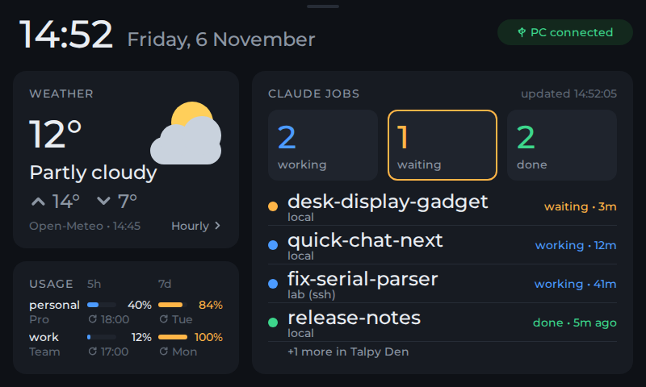
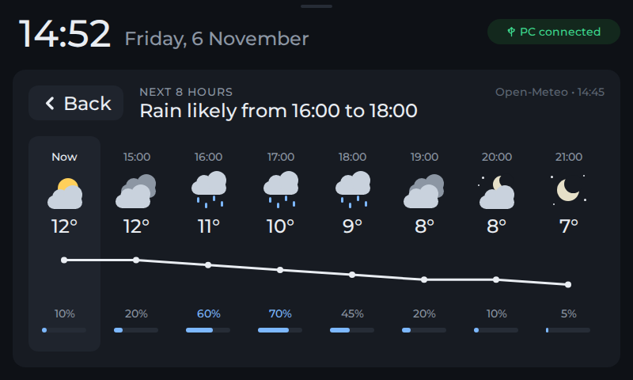
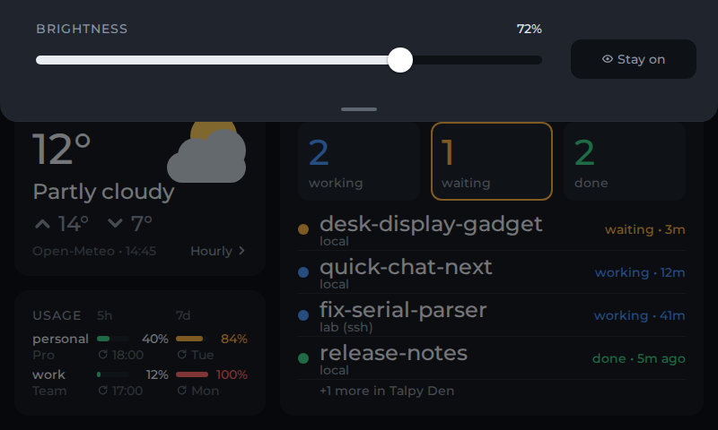
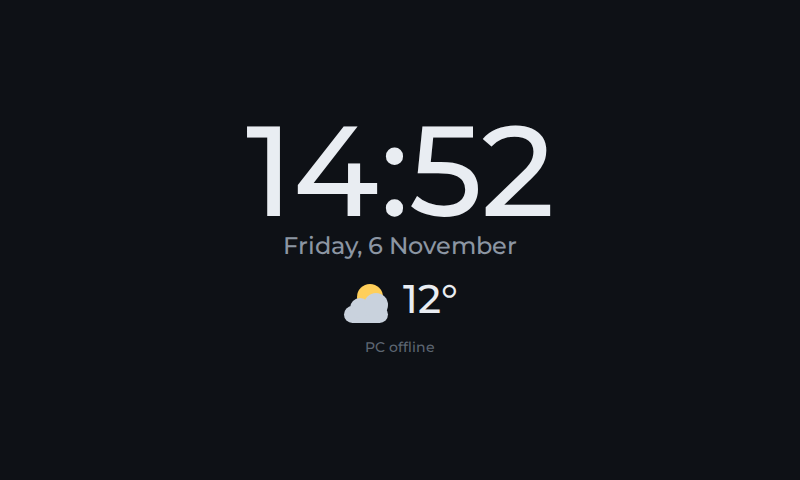
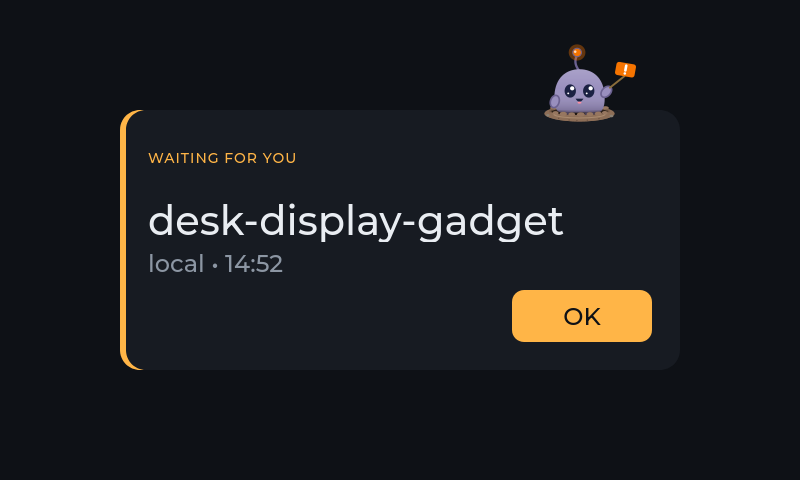
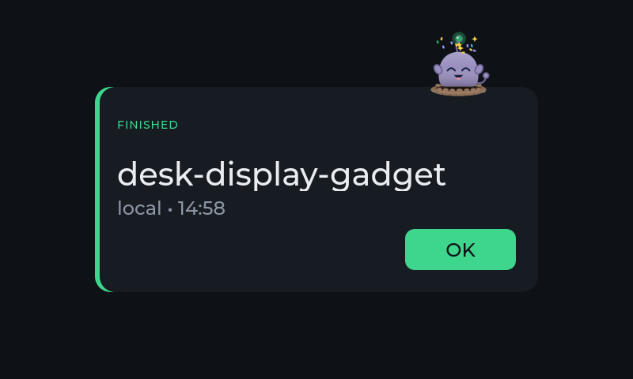

# Talpy Den Display

A desk display add-on for [Talpy Den](https://github.com/wzaielamri/talpy-den). A 4.3" touch screen
shows your Claude Code chats at a glance: which ones are working, which need you, and which just
finished. It also shows your plan usage, the time and the weather. Your Linux PC feeds it over USB
serial, so the board needs no Wi-Fi and holds no passwords or tokens.

Talpy Den writes the chats and usage to a small JSON file whenever something changes, and
`host/sync.py` passes them on to the board. Any other program can write that file too
(see [Feeding it](#feeding-it)).



| Next 8 hours (tap the weather) | Pull down from the top | Clock face |
|---|---|---|
|  |  |  |
| **A chat needs you** | **A chat finished** | |
|  |  | |

## What it does

- **Jobs:** counts every chat as working, waiting or done and lists four of them, waiting first, with
  where each one runs (`local`, `lab (ssh)`, `web (podman)`) and for how long. When more don't fit,
  it says how many more there are. The waiting tile pulses.
- **Alerts:** a full-screen alert when a chat starts waiting for you (stays until you tap OK), and a
  shorter one when a chat finishes (15 s).
- **Plan usage:** the 5-hour and 7-day windows of up to two accounts, with their reset times. A bar
  turns amber from 80%.
- **Weather:** now, today's high and low, and the next 8 hours with rain chances, from
  [Open-Meteo](https://open-meteo.com/) (no API key needed).
- **Brightness:** swipe down from the top for the brightness slider and a **Stay on** toggle. The
  board remembers both after a restart.
- **Clock face:** after 2 minutes without a touch, the screen switches to a big clock at half
  brightness. It doesn't switch while a chat is working or waiting, or while Stay on is set. It also
  shows the clock while the PC is away (no message for 60 s), so a board on a powered hub can stay on
  day and night. The clock moves a few pixels each minute so nothing burns in. Touch it to come back.

## Hardware

- **The display:** Elecrow's
  [CrowPanel Advance 4.3" HMI ESP32 AI Display](https://www.elecrow.com/crowpanel-advance-4-3-hmi-esp32-800x480-ai-display-ips-touch-artificial-intelligent-screen.html)
  (ESP32-S3, 800×480 IPS, GT911 touch, CH340 USB serial), sold with an acrylic case. This isn't an
  ad: I'm not affiliated with Elecrow, it's simply the board this was built on. It's the revision
  whose backlight controller sits at I2C address 0x30. Other revisions may need changes in
  `src/drivers/`.
- **A stand (optional):** mine is based on the 3D-printable
  [Tablet Studio Stand (adjustable)](https://makerworld.com/en/models/1081930-tablet-studio-stand-adjustable)
  on MakerWorld.
- A USB cable to a Linux PC. A powered USB hub is optional and keeps the board on while the PC is off.

## Quick start

You need [PlatformIO](https://platformio.org/) and Python 3 with pyserial (`sudo dnf install
python3-pyserial` or `sudo apt install python3-serial`). The first two lines below give the board a
fixed name, `/dev/desk-display`, and give you access to it: no `dialout` group needed.

```sh
sudo cp host/70-desk-display.rules /etc/udev/rules.d/
sudo udevadm control --reload && sudo udevadm trigger --subsystem-match=tty   # replug the board if needed
pio run -t upload                                # build and flash the board
python3 host/sync.py --demo                      # send made-up examples once: check every screen
printf 'DESK_LAT=\nDESK_LON=\n' > ~/.config/desk-display.env   # then put in your latitude and longitude
python3 host/sync.py --dry-run                   # print what it would send
python3 host/sync.py                             # the real thing (Ctrl+C to stop)
```

Your latitude and longitude stay out of the repository, in `~/.config/desk-display.env`. Without
them you get no weather. `--lat` and `--lon` override them for one run. If the board isn't
`/dev/ttyUSB0`, add `--port /dev/ttyUSBn`.

## Run it all the time

With the udev rule from the quick start the board keeps the name `/dev/desk-display`, whatever USB
port it's in. A systemd user service then starts `sync.py` when you log in and restarts it if it
stops. It reads the same `~/.config/desk-display.env`. Run these from the repository folder:

```sh
mkdir -p ~/.local/bin ~/.config/systemd/user
ln -sf "$PWD/host/sync.py" ~/.local/bin/desk-display-sync
cp host/desk-display-sync.service ~/.config/systemd/user/
systemctl --user daemon-reload
systemctl --user enable --now desk-display-sync

journalctl --user -u desk-display-sync -f        # what it sends, what the board answers
```

The service holds the serial port. To flash, stop it first:
`systemctl --user stop desk-display-sync && pio run -t upload && systemctl --user start desk-display-sync`.

## Feeding it

`host/sync.py` watches `$XDG_RUNTIME_DIR/talpy-den/jobs.json` with inotify, so there's no polling.
Talpy Den writes this file whenever a chat's state or an account's usage changes, by replacing it in
one rename. Its format is described in Talpy Den's
[how it works](https://github.com/wzaielamri/talpy-den/blob/main/docs/how-it-works.md#the-jobs-file).
To show jobs from another tool, write the same file the same way.

To skip `sync.py`, send the board one JSON object per line (under 8 KB) at 115200 baud yourself:

| `type` | Fields | `sync.py` sends it |
|---|---|---|
| `time` | `epoch`, `tz` (POSIX TZ string; the board keeps the last one, UTC until the first) | at the start and every 10 min |
| `jobs` | `rows`: `id`, `name`, `state` (`working`/`waiting`/`done`), `since` (Unix s), `machine` | when they change |
| `usage` | `accounts`: `name`, `plan`, `five_hour`, `seven_day` (%), `five_hour_resets`, `seven_day_resets` | when they change |
| `weather` | `temp`, `code` ([WMO](https://open-meteo.com/en/docs)), `day`, `hi`, `lo`, `updated` | every 15 min |
| `hourly` | `summary`, `updated`, `hours`: `at`, `temp`, `code`, `day`, `rain` | every 15 min |
| `power` | `state: "sleep"`: the PC is going away, show the clock | |
| `ping` | | after 10 s with nothing else sent |

For example: `{"type":"jobs","rows":[{"id":"1","name":"fix-parser","state":"waiting","since":1762600000}]}`.
The board makes the alerts itself by comparing each `jobs` message with the one before. Each
handler is documented in [`src/app/serial_link.cpp`](src/app/serial_link.cpp).

## Privacy

- `sync.py` makes one network call: the weather from Open-Meteo, with your latitude and longitude.
- Chat names go to the board as plain ASCII, and the board's log shows them, so `journalctl` does too.

## Design

[`design/desk-display-layout.html`](design/desk-display-layout.html) is the layout spec: every card's
position, size, colour, font and state, with the LVGL calls behind them. Download it and open it in
a browser (it loads its fonts from Google Fonts). The pictures above are exported from it.

The clock's digits are Montserrat Medium at 128 px. LVGL's built-in fonts stop at 48 px, so
[`tools/make_clock_font.py`](tools/make_clock_font.py) generates `src/ui/font_clock_128.c` (needs
Pillow):

```sh
python3 tools/make_clock_font.py .pio/libdeps/advance-hmi/lvgl/scripts/built_in_font/Montserrat-Medium.ttf 128 src/ui/font_clock_128.c
```

## Layout

```
src/main.cpp     setup and the main loop
src/app/         serial messages, alerts from job changes, when the clock shows, saved settings
src/ui/          cards, pull-down panel, alert, clock face, weather icons (LVGL 9.1)
src/drivers/     display, touch, backlight, real-time clock
include/         lv_conf.h, theme colours, pins
host/            sync.py, the udev rule, the systemd user service
design/          the layout spec and its pictures
tools/           the clock font generator
```

## Credits

Built with [LVGL](https://lvgl.io/), [LovyanGFX](https://github.com/lovyan03/LovyanGFX),
[ArduinoJson](https://arduinojson.org/) and [pioarduino](https://github.com/pioarduino/platform-espressif32).
The board setup (pins, panel timings, backlight controller) follows Elecrow's CrowPanel examples. The
clock digits come from [Montserrat](https://github.com/JulietaUla/Montserrat) (SIL Open Font License
1.1). Weather data by [Open-Meteo.com](https://open-meteo.com/) (CC BY 4.0). Claude is a trademark of
Anthropic, which this project isn't affiliated with.

## License

[MIT](LICENSE). The clock font in `src/ui/font_clock_128.c` is made from Montserrat and keeps its
SIL Open Font License 1.1.
